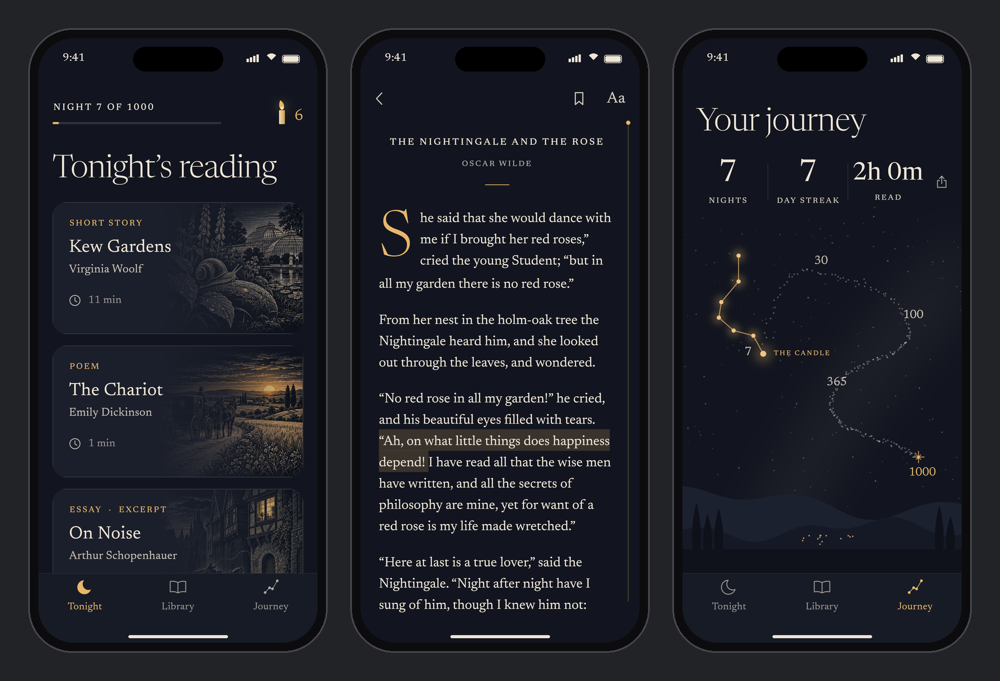
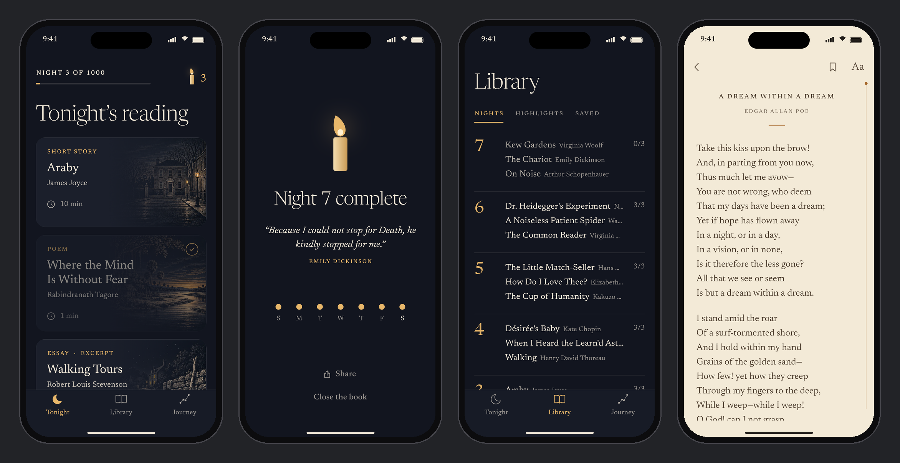

# 1000 Nights

> A thousand nights. One story, one poem, one essay.

1000 Nights is a reading habit app. For 1000 nights, it serves one short story,
one poem and one essay from the public domain each night. It is iOS-first,
built in Flutter, and local-first, with no account.

See the [PRD and build plan](docs/PRD.md) and the [progress log](docs/PROGRESS.md).



<sub>These are real screens rendered from the app with the bundled 7-night test pack
(night 7, after a debug jump). They are not mockups. The card engravings are the
generated art for nights 1 to 7 (see [docs/illustration-prompts.md](docs/illustration-prompts.md)).
The approved mockups are in
[docs/mockups](docs/mockups/approved-mockups.webp).</sub>



## Status

| Phase | State |
| --- | --- |
| 0. Foundations | ✅ Done. The gate passes in tests. |
| 1. Reading loop | ✅ Built. On-device run still to do. |
| 2. Habit | 🟡 Unlock and streak rules, plus Journey, are done. Onboarding and notifications are not. |
| 3. Paywall | 🟡 Library and highlights are done. RevenueCat and gating are not. |
| 4. Launch | 🟡 Reader settings and the motion pass are done. |
| Content | 🟡 Pipeline done, plus a 7-night test pack. Nights 8–90 are still to curate. |

See [docs/PROGRESS.md](docs/PROGRESS.md) for the item-by-item log.

## Run it

You need Flutter 3.47+ (Dart 3.13+). Building for iOS needs a Mac with Xcode.

```bash
flutter pub get
flutter run                 # iOS simulator or device
flutter test                # unit + widget tests
flutter analyze
```

In debug builds, long-press **NIGHT N OF 1000** on Tonight to open the debug
menu. From there you can move the clock, jump to a night, finish tonight, or
reset.

### Regenerating things

```bash
dart run build_runner build                                   # Drift code (lib/data/database.g.dart)
python3 content/tools/build_pack.py --pack 1 --nights 1-7     # content pack + measure report
python3 content/tools/placeholder_art.py --pack 1             # placeholder engravings (needs Pillow)
flutter test test/screenshots --dart-define=SCREENSHOTS=true  # docs/screenshots/*.png
python3 tool/frame_screenshots.py                             # phone-framed hero images
```

## Project layout

```
lib/
  core/        theme tokens, router, providers, analytics, shared widgets (candle, icons)
  data/        Drift schema, content pack importer, ReadingRepository
  domain/      pure rules: LocalDate, NightRules (unlock), StreakRules (streak + freezes)
  features/    tonight, reader, night_complete, journey, library, shell, debug
assets/
  fonts/       Newsreader (OFL) static cuts
  packs/       pack-001.json + card images (bundled, so night 1 works offline)
content/       master sheet, pipeline scripts, manual texts, measure reports
docs/          PRD, progress log, pack format, screenshots, mockups
test/          domain, data, widget and screenshot tests
tool/          screenshot framing
```

## Stack

- **Flutter**, iOS first.
- **Riverpod 3** for state, **Drift** (SQLite) for storage, **go_router** for navigation.
- Planned: RevenueCat (subscriptions), a static CDN for content packs, and PostHog or Firebase (analytics).

## Content and rights

Every text is published in 1930 or earlier (for translations, the translation's
year counts), and carries a `rights_note`. The pipeline cuts each piece from the
Project Gutenberg text and strips the Gutenberg header and licence. The app does
not use the Project Gutenberg name or logo. This is a working rule, not legal
advice: the content list needs a legal review before launch. See
[content/README.md](content/README.md).
